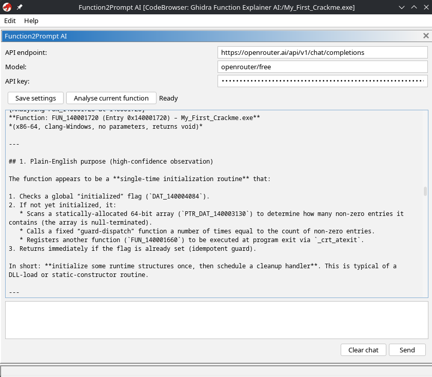

# Function2Prompt



Function2Prompt is a Ghidra extension that helps reverse engineers send decompiled function code and metadata directly to an AI assistant for analysis, explanation, and follow-up investigation.

It connects Ghidra's decompiler output with an AI chat flow so you can quickly ask questions about a function without manually copying code between tools.

## Features

- Extracts function code and metadata from Ghidra
- Sends the selected function context to an AI assistant
- Keeps the analysis workflow inside the reverse engineering environment
- Useful for code understanding, reversing questions, and documentation help

## Requirements

- Ghidra 12.1.2
- Java 21 JDK (recommended and required for Ghidra 12.1.x)
- A working Ghidra installation

Important: This extension is built for the Ghidra 12.1.x line and is expected to run with the Java version used by that Ghidra release. For Ghidra 12.1.2, use Java 21. Do not use older Java versions unless you are specifically targeting a compatible Ghidra build.

## Downloading the compiled extension

The compiled extension can be found in the `dist/` folder of this repository.

Example artifact:

- `dist/ghidra_12.1.2_DEV_20261102_Function2Prompt-v0.2-in-extension-settings.zip`

This is the file that should be uploaded to the GitHub Releases page or shared as the packaged extension for installation.

## Installing the extension in Ghidra

1. Download or build the extension ZIP file from the `dist` folder.
2. Open your Ghidra project or launch Ghidra.
3. In the Ghidra window, go to:
   - `File -> Install Extension...`
   - or, on some versions: `Help -> Manage Extensions`
4. Select the extension ZIP file from the `dist` folder.
5. Click `Install` and allow Ghidra to load the extension.
6. Restart Ghidra if prompted.
7. After restart, verify the extension is enabled and available in the Ghidra UI.

## Installing from a release artifact

If you want to distribute the compiled version publicly:

1. Copy the ZIP from `dist/` to the release assets for the GitHub Release.
2. Upload it to the repository's Releases page.
3. Share the release link or the direct download URL for the ZIP file.

This ensures users can install the extension by downloading the packaged release artifact instead of building it from source themselves.

## Building from source

If you want to build the extension manually:

```bash
export GHIDRA_INSTALL_DIR=/path/to/ghidra
./gradlew buildExtension
```

The resulting ZIP will be generated under the build output area and can then be copied into the release assets or the `dist` folder as needed.

## Notes

- The extension version currently matches the Ghidra compatibility target: `12.1.2`.
- If you are using a different Ghidra version, make sure you build or download a matching extension package for that Ghidra version.
